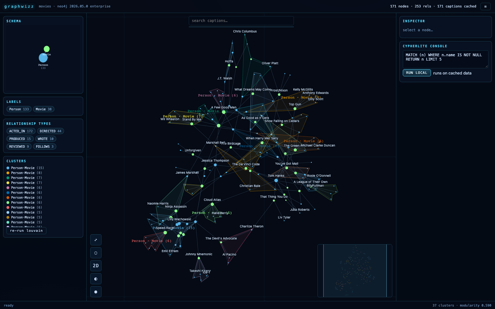

# graphwizz

**Next-generation Neo4j graph exploration, running entirely in your browser.**

graphwizz connects directly to a Neo4j HTTP endpoint, understands a database's topology in seconds (even at 50M+ nodes), stages an explorable subgraph with lazy background enrichment, clusters it locally with Louvain, renders it with pluggable renderers, and caches everything in a local **CypherLite** store that survives reloads and is queryable with a Cypher subset — all wrapped in a dark HUD with schema minimap, cluster hulls and semantic zoom.

<!-- Drop a screenshot at docs/screenshot.png and it will render here. -->


---

## Contents

1. [Quick start](#quick-start)
2. [Connecting to databases](#connecting-to-databases)
3. [Using the demo HUD](#using-the-demo-hud)
4. [Architecture](#architecture)
5. [How loading works (the pipeline)](#how-loading-works-the-pipeline)
6. [Performance — measured](#performance--measured)
7. [Debugging & observability](#debugging--observability)
8. [Using graphwizz as a library](#using-graphwizz-as-a-library)
9. [Testing](#testing)
10. [Ideas & roadmap](#ideas--roadmap)
11. [Project docs](#project-docs)

---

## Quick start

Requirements: Node 20+ (Node 24 used in development). No database of your own needed — the demo presets point at the public `demo.neo4jlabs.com` server.

```bash
npm install          # npm workspaces: library + demo
npm run dev          # Vite dev server → http://localhost:5173
```

Open http://localhost:5173, pick a preset from the dropdown, hit **CONNECT**. That's it.

Other commands:

```bash
npm run build        # production builds (library ESM + demo bundle)
npm run preview      # serve the built demo (port 4173)
npm test             # vitest unit tests (library)
```

End-to-end checks against the live demo server (useful after cloning, no browser needed):

```bash
node scripts/smoke.mjs movies          # tiny dataset
node scripts/smoke.mjs ckg             # 18M nodes / 200M rels
node scripts/topology-trace.mjs ckg    # per-phase + per-query performance trace
```

---

## Connecting to databases

The connect panel accepts four input styles:

1. **Presets** — dropdown of databases verified live on `https://demo.neo4jlabs.com:7473`:

   | Preset | Database | Credentials | Scale |
   |---|---|---|---|
   | Movies | `movies` | `movies` / `movies` | 38 movies — start here |
   | Northwind | `northwind` | `northwind` / `northwind` | classic retail schema |
   | StackOverflow | `stackoverflow` | `stackoverflow` / `stackoverflow` | 8.9M users, 41.8M posts |
   | ClinicalKnowledgeGraph | `clinicalknowledgegraph` | `ClinicalKnowledgeGraph` / `ClinicalKnowledgeGraph` | 18M nodes · 200M rels · 35 labels |
   | Diffbot companies | `diffbotcompanies` | `diffbot` / `diff_bot` | 56M organizations |

2. **Manual** — URI, username, password, database fields.
3. **Drag & drop an env file** — any `.env`/`.txt`/`.json` file with `NEO4J_URI`, `NEO4J_USERNAME`, `NEO4J_PASSWORD`, `NEO4J_DATABASE` lines dropped onto the panel is parsed and auto-connects. Quotes and inline comments are handled.
4. **Session restore** — "restore last session" reloads the previous explore from the browser's IndexedDB without touching the network.

Notes for private servers:

- **CORS**: the demo server sends `Access-Control-Allow-Origin: *`, so browsers connect directly. Self-hosted Neo4j needs `server.http_access_control_allow_origin` (or TLS-terminating proxy headers). Alternatively run the built-in dev proxy:
  ```bash
  NEO4J_PROXY_TARGET=https://my-server:7473 npm run dev
  ```
  and pass `proxyPath: '/neo4j-proxy'` in the connection (the library prefixes all requests with it).
- **Protocol**: graphwizz speaks the modern **Query API** (`POST /db/{db}/query/v2`, plain JSON) and automatically falls back to the legacy transactional endpoint (`/db/{db}/tx/commit`) on older 5.x servers. Rate limiting (HTTP 429) is handled with adaptive pacing + retries.
- **Composite databases** (e.g. `diffbot`): metadata procedures fail with *"Graph access operations are not supported on composite databases"* — the UI surfaces this and you connect to a constituent database (`diffbotcompanies`) instead.
- The last connection is remembered in `localStorage`; the last *graph* is remembered in IndexedDB per database.

---

## Using the demo HUD

| Area | What it does |
|---|---|
| **Schema pane** (left) | meta-graph of labels sized by node count on a radial layout, edges = sampled relationship types with exact count-store totals; **wheel-zoom + drag-pan**, hover = property keys + edge list, click = toggle label filter |
| **Labels / Rel types chips** | click to hide/show in the main view (counts shown inline) |
| **Clusters legend** | Louvain communities with dominant labels; "re-run louvain" re-clusters |
| **Main canvas** | force layout (worker), semantic zoom (dots → halos → labels), cluster hulls, hover-dimming of non-neighbors, node drag with reheat, lasso multi-select |
| **Minimap** (bottom right) | cluster-colored point cloud + viewport rectangle; click/drag to navigate |
| **Search** (top) | prefix search over the cached caption roster (bulk-pulled per label in the background) |
| **Inspector** (right) | selected node's labels, all properties, loaded-edge summary, "expand neighbors" |
| **CypherLite console** | run the Cypher subset **against the cached graph** — works offline after load |

Controls: drag = pan · wheel = zoom (pinch works) · click = select + prefetch neighbors · hover = load details · drag node = reposition + reheat · `F` = fit · `L` = lasso · `+`/`-` = zoom · double-click node = focus, double-click background = fit · `Esc` = exit lasso · toolbar: fit, lasso, renderer switch (2D↔SVG), color by label↔cluster, PNG screenshot.

The URL flag `?debug` logs every server request (statement, duration, 429s) to the browser console.

---

## Architecture

```
┌────────────────────────────  browser  ────────────────────────────┐
│                                                                   │
│  demo app (packages/demo) — HUD, connect panel, inspector         │
│        │                                                          │
│  GraphExplorer (src/explorer.ts) — the orchestrator façade        │
│        │                                                          │
│  ┌─────┴──────────────────────────────────────────────────────┐   │
│  │ core/        GraphModel: Map-based property graph +        │   │
│  │              parallel typed arrays (x/y/degree/cluster/…)  │   │
│  │ neo4j/       Neo4jClient (Query API v2 → legacy fallback,  │   │
│  │              adaptive pacing, per-query events)            │   │
│  │              fetchTopology (count store + stratified       │   │
│  │              UNION-ALL sampling)  ·  GraphLoader (seeds →  │   │
│  │              expansion)  ·  Prefetcher (hover/select       │   │
│  │              priority queue, requestIdleCallback)          │   │
│  │ algorithms/  CSR typed-array graph + Louvain, label        │   │
│  │              propagation, PageRank, components — run in a  │   │
│  │              Web Worker (main-thread fallback)             │   │
│  │ layout/      d3-force in a Web Worker; streams position    │   │
│  │              snapshots; cluster gravity after Louvain      │   │
│  │ render/      GraphRenderer SPI + registry; Canvas2D        │   │
│  │              (semantic zoom, hulls, lasso, label collision │   │
│  │              grid), SVG, Minimap, SchemaMap                │   │
│  │ cypherlite/  local store: in-memory graph + IndexedDB      │   │
│  │              persistence + mini-Cypher interpreter         │   │
│  │ adapters/    NVL adapter (optional peer dep)               │   │
│  └────────────────────────────────────────────────────────────┘   │
└──────────────────────────────┬────────────────────────────────────┘
                               │ HTTPS (Query API v2, plain JSON)
                        ┌──────┴──────┐
                        │  Neo4j HTTP │  count store · degree store ·
                        │  endpoint   │  procedures · lazy LIMIT samples
                        └─────────────┘
```

Key design decisions (full log in [PLAN.md](PLAN.md)):

- **Topology-first, never full scans.** Labels/types/counts come from procedures + the **count store** (instant even at 56M nodes); schema edges from stratified per-rel-type samples with per-query aborts; the expensive phases run as background *enrichment* after the view paints.
- **All queries return explicit primitive columns** (`elementId(n)`, `labels(n)`, `properties(n)`, `type(r)`) so the v2 and legacy endpoints share one parser.
- **Everything incremental**: the graph grows by merging `GraphPatch`es; layout and clustering re-run locally on typed arrays; the server is never asked for aggregates over all relationships (measured: that's the difference between 0.4s and >25s per query).
- **Workers everywhere, with fallbacks.** Layout and algorithms run off-thread, communicating via structured-clone/transferable typed arrays; every worker has a main-thread path so the library also works in tests/SSR.
- **Renderers are pluggable** behind a small SPI (`GraphRenderer`); Canvas2D is the default, SVG proves the abstraction, the NVL adapter shows third-party backends slot in.
- **Local-first**: CypherLite mirrors everything loaded, persists per-database to IndexedDB, and answers a Cypher subset (`MATCH (n:Label) WHERE … RETURN … ORDER BY … LIMIT`, outgoing hops, `count(*)`, `IN`/`CONTAINS`/`STARTS WITH`/`IS [NOT] NULL`). The store interface is the seam for a real WASM engine (kuzu-wasm) later.

---

## How loading works (the pipeline)

1. **Connect** — unauthenticated `GET /` discovery (version/edition for the header), authenticated probe.
2. **Topology (paint-blocking, target < 5s on huge DBs)** — `db.labels()` + `db.relationshipTypes()`; label counts as **UNION-ALL batches** (10–12 per round-trip — verified to keep the count store); typed-rel counts individually (UNION defeats the count store there); per-label property probes → caption-key inference; one cheap lazy edge sample.
3. **Background enrichment** — per-rel-type schema-edge probes (count-descending, 2.5s abort each) + exact `(:L)-[:T]->()` marginals; results flow into the schema map when they land.
4. **Initial view** — N seeds per label with inferred captions + true degree-store degrees (`count { (n)--() }`), then 1-hop expansion rounds within a node budget.
5. **Lazy layer** — hover → medium-priority detail fetch, click → high priority, neighbors → low; deduped, idle-scheduled, cancellable.
6. **Layout & clustering** — force simulation in a worker; Louvain assigns communities → hulls + cluster gravity; label/PageRank available on demand.
7. **Persistence** — every merge lands in CypherLite; "restore last session" (or page reload + restore) replays it without the network.

---

## Performance — measured

All numbers from the live `demo.neo4jlabs.com` server (Oct 2026), built library:

| Database | Topology (paint-blocking) | Initial view | Enrichment (background) | Louvain |
|---|---|---|---|---|
| movies (171 nodes) | ~2–3s | ~2s | +1s | 37 clusters, Q 0.59 |
| StackOverflow (8.9M users) | ~4.5s | ~1.6s | +1s | 25 clusters, Q 0.82 |
| ClinicalKnowledgeGraph (18M nodes, 200M rels) | **~3s** | ~3s | +13s | 93 clusters, Q 0.65 |
| Diffbot companies (56M orgs) | same code path | — | — | — |

The remaining wall-clock is dominated by server round-trip latency (~0.8s/query to the demo server), not query cost — which is why the pipeline batches (UNION ALL) and parallelizes wherever the count store survives it.

---

## Debugging & observability

- **`?debug`** — per-request console lines: `[gq] 412ms ok MATCH (n:User)…`, throttles flagged.
- **Topology timings** — printed to the console automatically (`topology.timings`: `procedures`, `counts`, `propSamples`, `edgeSample`, `edgeProbes`, `marginals`, plus query counts).
- **`node scripts/topology-trace.mjs <db>`** — the deep tool: phase walls, per-type probe table, slowest queries, requests/second timeline. This is what identified the CKG rare-type scan trap and the UNION-ALL count-store defeat.
- **Live integration test** — `GRAPHWIZZ_LIVE=1 GRAPHWIZZ_DB=ckg npx vitest run tests/integration.live.test.ts` asserts on the real pipeline and prints timing tables.
- **`node scripts/smoke.mjs <db>`** — end-to-end data-layer run: discovery → topology → load → Louvain → CypherLite console.

---

## Using graphwizz as a library

The demo is a thin client; everything is importable from `graphwizz` (only runtime dependency: `d3-force`).

```ts
import { GraphExplorer } from 'graphwizz'

const app = new GraphExplorer({ container: document.getElementById('stage')! })
await app.connect({ uri, username, password, database })
const topo = await app.loadTopology()          // schema, counts, caption keys (enriches in background)
await app.loadInitialView({ seedsPerLabel: 12, maxNodes: 1600 })

app.events.on('select', ({ ids }) => app.prefetch(ids, 'high'))
app.events.on('topology', (t) => renderSchemaMap(t))   // fires again when enrichment lands

app.cypher('MATCH (n:User) WHERE n.name STARTS WITH "a" RETURN n.name AS n LIMIT 10')
await app.cluster('louvain')                   // or 'labelprop'
app.setHiddenLabels(['Tag'])
```

Lower-level pieces are all exported for independent use:

```ts
import { Neo4jClient, fetchTopology, enrichTopology } from 'graphwizz'   // data layer
import { GraphModel, louvain, pagerank, components } from 'graphwizz'    // model + algorithms
import { LayoutRunner } from 'graphwizz'                                 // worker force layout
import { CanvasRenderer, SvgRenderer, Minimap, SchemaMap } from 'graphwizz/renderers'
import { CypherLite, runCypher } from 'graphwizz/cypherlite'
```

Plugging a renderer (the SPI — three methods to get a working backend, the rest optional):

```ts
app.switchRenderer('my-renderer', (model, callbacks) => new MyRenderer(model, callbacks))
```

The NVL adapter (`src/adapters/nvl-adapter.ts`) shows the pattern for third-party stacks: it lazy-loads `@neo4j-nvl/base` (2.0 has a WebGL renderer) and maps the model into NVL nodes/rels. Note NVL's license restricts it to Aura / Neo4j commercial products.

---

## Testing

```bash
npm test                                    # 28 unit tests, no network
GRAPHWIZZ_LIVE=1 GRAPHWIZZ_DB=ckg \
  npx vitest run tests/integration.live.test.ts   # live integration + timing tables
node scripts/smoke.mjs ckg                  # built-library end-to-end
```

Unit coverage: Louvain on planted partitions (purity + modularity), mini-Cypher parser/evaluator (14 cases), GraphModel merge/visibility/edge arrays, caption inference, env-file parsing.

---

## Ideas & roadmap

Ordered by research-backing (details in `research/03` and `research/04`):

1. **"More like this"** — exemplar-query style local Personalized PageRank seeded at the selection, with edge-label IDF weighting (Mottin et al., PVLDB 2014) — runs entirely on CypherLite.
2. **Geo layer** — Neo4j `POINT` arrives as WKT in plain JSON; parse it (or detect `lat`/`lon` props), project equirectangular, use coordinates as layout anchors; OSM basemap as demo opt-in.
3. **Time slider** — timestamp properties are already sampled; filter + replay the layout over time windows.
4. **kuzu-wasm backend** — real Cypher in the browser behind the CypherLite interface (the store facade is designed for exactly this swap).
5. **WebGL renderer** behind the SPI (or evaluate NVL 2.0's — license permitting) for 100k+ node canvases.
6. **Matrix/density view** for dense subgraphs (<1000 nodes, high link density) — complements node-link.
7. **Focused mining** — local community detection around a seed set (FocusCO-style), center-piece subgraphs connecting a selection.
8. **Session sharing** — export/import CypherLite snapshots (the IndexedDB payload is already a plain JSON structure).
9. **Server-side schema caching** — persist topology per connection so reconnects are instant.

---

## Project docs

| Doc | Contents |
|---|---|
| [`PLAN.md`](PLAN.md) | architecture decisions log, milestone status |
| [`research/01-neo4j-query-api-and-connectivity.md`](research/01-neo4j-query-api-and-connectivity.md) | live-verified Query API endpoints/headers/JSON shapes, CORS, count-store + UNION-ALL batching matrix, demo-server dataset cheat-sheet (incl. CKG sampling lessons) |
| [`research/02-visualization-library-landscape.md`](research/02-visualization-library-landscape.md) | NVL (incl. 2.0 findings), vasturiano/force-graph, anvaka/ngraph — with the engineering checklist distilled from each |
| [`research/03-graph-exploration-research.md`](research/03-graph-exploration-research.md) | CIKM 2016 "user in the loop" taxonomy → feature mapping; Hunger's incremental-loading recipe; visualization best practices |
| [`research/04-browser-store-algorithms-gis-future-ui.md`](research/04-browser-store-algorithms-gis-future-ui.md) | browser Cypher engine survey (kuzu-wasm verdict), worker algorithms, GIS layering, FUI/HUD design language |
| `scripts/` | `smoke.mjs` (end-to-end), `topology-trace.mjs` (perf analysis) |

## Status

Working end-to-end against five live datasets (verified numbers above); 28 unit tests green; library (~13 kB gzipped core) and demo build clean. This is a research/prototype codebase — APIs will move.
